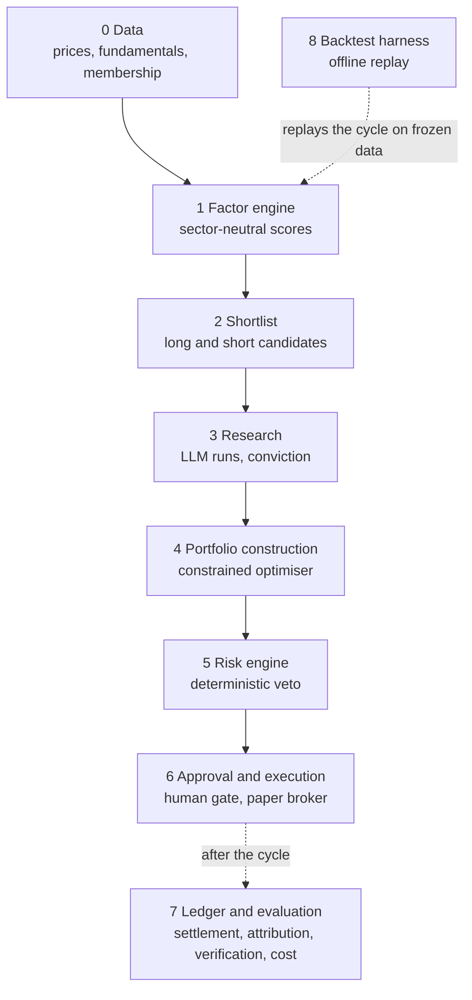

# Architecture

The system is built in layers, numbered 0 to 8. Layers 0 to 6 run in order inside every cycle, which also records the LLM spend. Layer 7 settles, attributes and verifies afterwards, as separate commands. Layer 8 replays the cycle over history.

## The layers

**0. Data.** Prices, company fundamentals and universe membership, read through interfaces (ports) so a real provider, a frozen store or a test double can stand behind them. Fundamentals are filtered to what had been filed on the date being modelled.

**1. Factor engine.** Eight factors, scored sector by sector so a name is compared with its own sector. Four use prices: 12-month momentum skipping the latest month, low volatility, one-month reversal and proximity to the 52-week high. Four use fundamentals: earnings yield, gross profitability, revenue growth and size. Quality gates (Piotroski and Altman) exclude names before scoring. The result is a composite score per name.

**2. Shortlist.** From the scores, up to three long and three short candidates per sector, capped at 40 names in total by default. Longs need a positive composite, shorts a negative one.

**3. Research.** The LLM layer researches each shortlisted name several times. Each run's rating is aligned to the candidate's side. The mean and the spread across runs give a verdict: confirm, contradict, neutral, or insufficient when too few runs are valid. A per-cycle budget decides how many runs per name and how many names.

**4. Portfolio construction.** A constrained optimiser turns scores and conviction into target weights. The limits include gross exposure, a cap on any single name, a beta band around zero, net and gross limits per sector, and a minimum number of names on each side.

**5. Risk engine.** Deterministic checks on the whole target book, with veto power: exposure limits, risk limits from a factor risk model, and circuit breakers on daily loss and drawdown. See [Design rules](design-rules.md).

**6. Approval and execution.** A plan that the risk engine has not blocked is shown to an approval gate. Only an explicit yes sends orders, to a paper broker.

**7. Ledger and evaluation.** What was decided, what filled, and what it cost. Settlement reconciles fills; attribution splits profit and loss by name, sector and factor; thesis verification checks, after the holding period, whether the research claims held up; LLM spend is recorded per cycle.

**8. Backtest harness.** An offline replay of the deterministic core over frozen, point-in-time data, net of simulated trading costs. The LLM layer is replaced by a neutral stand-in. See the Backtest methodology page.

## How the code is arranged

Pure logic (domain types and the engine) is separate from everything that touches the outside world. Services orchestrate the engine over injected ports. Adapters implement the ports for real systems. The command-line module is the composition root: it wires the adapters into the services and is the only place that builds a broker. The dashboard loader also imports adapters, but only to read stored reports.
